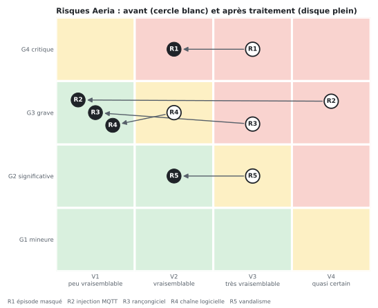

# Aeria · Security

[](https://github.com/brinis-aya/aeria-security/actions/workflows/ci.yml)

Module 5 of **Aeria**, an open air-quality monitoring platform. This repository is the security work on the
whole platform: an **EBIOS Risk Manager** risk analysis, a **technical audit** (nmap, Varys, web checks,
dependency scan) with fixes applied to the other modules and re-tested, **Wazuh** detection rules, and an
**ISO/IEC 27001:2022** statement of applicability.

> Other modules: [IoT sensors](https://github.com/brinis-aya/aeria-iot-sensors) ·
> [data pipeline](https://github.com/brinis-aya/aeria-data-pipeline) ·
> [24 h forecast](https://github.com/brinis-aya/aeria-forecast) ·
> [back-office](https://github.com/brinis-aya/aeria-backoffice) ·
> [dashboard](https://github.com/brinis-aya/aeria-dashboard) ·
> [overview](https://github.com/brinis-aya/aeria)

## Findings and fixes

| # | Finding | Severity | Fix | Verified by |
|---|---|---|---|---|
| F1 | Back-office listening on every interface over HTTP (credentials in clear on the Wi-Fi) | high | loopback by default, TLS reverse proxy | nmap before: 8084 open → after: closed |
| F2 | MQTT broker accepts anonymous publishers: anyone can forge readings | high | production config: per-sensor accounts and ACL, TLS 8883 | 4/4 checks in the broker |
| F3 | No protection against password guessing | medium | lock after 5 failures in 15 min | 20 wrong passwords → right one refused |
| F4 | Spring Boot one year old: 69–76 known vulnerabilities (Tomcat, Thymeleaf…) | high | Spring Boot 3.5.16 + patched Tomcat, Jackson, pgjdbc; weekly OSV scan | 76 → 3 (two not applicable: XsltView, SSE) |
| F5 | Forecast API without security headers, server banner | low | headers middleware, `--no-server-header` | web checks |
| F7 | No security events logged | medium | `AERIA-SECURITY` log + Wazuh rules | 15/15 scenarios on Wazuh 4.14.9 |

The fixes live in the modules themselves (commits referencing the finding numbers); this repository holds
the evidence: raw nmap outputs, Varys evidence export with its SHA-256 hash chain, web checks before and
after, OSV reports, `wazuh-logtest` results ([`docs/audit/raw`](docs/audit/raw)).

## Risk analysis (EBIOS RM)



Five workshops in [`docs/ebios-rm.md`](docs/ebios-rm.md):

- 5 business values and 12 supporting assets;
- 7 feared events, the worst being a **pollution episode hidden** from the public (G4);
- 6 risk sources, 5 strategic scenarios, operational scenarios mapped to MITRE ATT&CK;
- a 13-measure treatment plan.

The main residual risk is physical tampering with a low-cost sensor: it cannot be prevented, only detected by
cross-checking against reference stations and the forecast model.

## Wazuh

[`wazuh/`](wazuh): decoders and 15 rules for the back-office security log, the sensor ingestion service and
Mosquitto, with MITRE ATT&CK mapping. Among them: password guessing, **successful login right after password
guessing** (level 12), privilege abuse, bursts of rejected readings from one sensor (forged data), MQTT credential
guessing, clear-text MQTT from the network. Tested in CI against the official `wazuh-manager:4.14.9` image.

## ISO 27001

[`docs/iso27001-soa.md`](docs/iso27001-soa.md): 35 Annex A controls, 19 applied, 13 partial, 3 planned. Each
one is linked to evidence in the repositories or to a measure of the treatment plan.

## Reproduce

```bash
WORKSTATION_IP=<your own LAN address> bash scripts/run_audit.sh      # scan only what you own
python scripts/test_wazuh_rules.py --container <disposable wazuh manager>
python scripts/osv_scan.py --maven module=deps.txt --pypi module=requirements.txt --out osv.json
python scripts/risk_matrix.py
```

## Report

French report: [`docs/rapport.md`](docs/rapport.md). The ANSSI SecNumacadémie MOOC certificate is to be added
by the author (see the report).

## License

MIT
