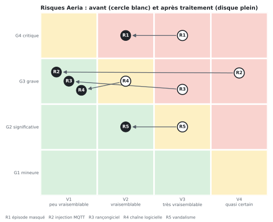

# Analyse de risques EBIOS Risk Manager — plateforme Aeria

Méthode : EBIOS Risk Manager (ANSSI, version 2018). Étude réalisée en novembre 2026 sur la plateforme Aeria
(modules 1 à 6). Les vraisemblances « avant » s'appuient sur les constats techniques de l'audit
([`audit.md`](audit.md)), et non sur des hypothèses.

**Échelles utilisées**

| Gravité | Signification pour Aeria |
|---|---|
| G1 Mineure | gêne interne, sans effet pour le public |
| G2 Significative | service dégradé quelques jours, données personnelles limitées exposées |
| G3 Grave | information publique fausse ou indisponible, atteinte à la crédibilité, obligation de notification |
| G4 Critique | atteinte possible à la santé : un épisode de pollution non signalé à des personnes vulnérables |

| Vraisemblance | Signification |
|---|---|
| V1 Peu vraisemblable | demande des moyens importants, aucune trace d'occurrence |
| V2 Vraisemblable | possible avec des moyens modérés |
| V3 Très vraisemblable | à la portée d'un attaquant motivé, ou déjà observé |
| V4 Quasi certain | à la portée de n'importe qui, sans compétence particulière |

---

## Atelier 1 — Cadrage et socle de sécurité

### Missions

1. **Mesurer** la qualité de l'air au Havre (réseau de capteurs, module 1).
2. **Informer** le public : indice ATMO observé et prévu à J+1 (modules 2, 3, 6).
3. **Maintenir** le parc de capteurs (module 4).

### Valeurs métier (VM) et besoins de sécurité

| VM | Description | Disponibilité | Intégrité | Confidentialité | Traçabilité |
|---|---|---|---|---|---|
| VM1 | Mesures de qualité de l'air (brutes et validées) | ++ | +++ | + | ++ |
| VM2 | Indice et prévision publiés | ++ | +++ | public | ++ |
| VM3 | Gestion de la maintenance (tickets, interventions, stock) | ++ | ++ | + | +++ |
| VM4 | Données personnelles des techniciens et comptes | + | ++ | +++ | ++ |
| VM5 | Code source et chaîne de livraison | + | +++ | public | ++ |

### Biens supports (BS)

| BS | Bien support | VM portées |
|---|---|---|
| BS1 | Capteurs ESP32 installés sur la voie publique (mâts, façades) | VM1 |
| BS2 | Connexion réseau des sites (Wi-Fi des bâtiments municipaux) | VM1 |
| BS3 | Broker MQTT Mosquitto | VM1 |
| BS4 | Service d'ingestion Spring Boot (module 1) | VM1 |
| BS5 | PostgreSQL : base opérationnelle, entrepôt, base du back-office | VM1, VM3, VM4 |
| BS6 | Pipeline ETL et sources ouvertes (LCSQA / data.gouv.fr, Open-Meteo) | VM1, VM2 |
| BS7 | API de prévision FastAPI et modèle entraîné | VM2 |
| BS8 | Back-office web (module 4) | VM3, VM4 |
| BS9 | Tableau de bord public (module 6) | VM2 |
| BS10 | GitHub : dépôts, GitHub Actions, dépendances Maven / PyPI | VM5 |
| BS11 | Poste d'administration / développement | toutes |
| BS12 | Personnel : responsable maintenance, techniciens | VM3 |

### Événements redoutés (ER)

| ER | Événement redouté | VM | Impacts | Gravité |
|---|---|---|---|---|
| ER1 | Des mesures falsifiées sont publiées comme vraies | VM1, VM2 | désinformation, perte de crédibilité, mauvaises décisions | G3 |
| ER2 | Un épisode de pollution est **masqué** (aucune alerte) | VM2 | personnes vulnérables exposées sans prévention, responsabilité | **G4** |
| ER3 | Une fausse alerte « Mauvais / Très mauvais » est publiée | VM2 | inquiétude du public, relais médiatique, discrédit | G3 |
| ER4 | La collecte est indisponible plus de 48 h | VM1 | trous dans les séries, prévisions dégradées | G2 |
| ER5 | Le back-office est indisponible ou son historique perdu (rançongiciel) | VM3 | maintenance aveugle, perte de traçabilité | G3 |
| ER6 | Les données personnelles et identifiants fuient | VM4 | notification CNIL (RGPD art. 33), réutilisation des mots de passe | G2 |
| ER7 | Une porte dérobée est introduite dans le code ou les images | VM5 | compromission durable de toute la plateforme | G3 |

### Socle de sécurité

Référentiels :

- guide d'hygiène informatique de l'ANSSI ;
- ISO/IEC 27001:2022, annexe A (déclaration d'applicabilité : [`iso27001-soa.md`](iso27001-soa.md)) ;
- RGPD.

| Thème du socle | État initial (audit) | Écart | Traitement |
|---|---|---|---|
| Authentifier les équipements | broker MQTT en accès anonyme (configuration de développement) | **oui** | configuration de production : comptes par capteur et ACL (corrigé, testé) |
| Chiffrer les flux | MQTT et back-office en clair | **oui** | TLS 8883 pour MQTT (configuration livrée) ; HTTPS par proxy inverse (planifié) |
| Cloisonner, réduire la surface | back-office à l'écoute sur toutes les interfaces | **oui** | écoute sur la boucle locale par défaut (corrigé, vérifié par nmap) |
| Politique d'authentification | aucune limite de tentatives, pas de MFA | **oui** | verrouillage après 5 échecs (corrigé) ; MFA (planifié) |
| Journaliser | aucun événement de sécurité tracé | **oui** | journal `AERIA-SECURITY` et règles Wazuh (corrigé, testé) |
| Maintenir à jour | Spring Boot vieux d'un an : 69 à 76 vulnérabilités connues | **oui** | mise à jour en 3.5.16 et analyse OSV récurrente (corrigé) |
| Sauvegarder | pas de sauvegarde automatisée des bases | **oui** | `pg_dump` chiffré quotidien hors site (planifié) |
| Gérer les droits | deux rôles, contrôle d'appartenance des interventions | non | — |
| Protéger les données | mots de passe BCrypt, données personnelles minimales | non | — |

---

## Atelier 2 — Sources de risque et objectifs visés

Pertinence = motivation × ressources × activité (1 à 4 chacun), ramenée en trois niveaux.

| SR | Source de risque | OV : objectif visé | Motiv. | Ress. | Activité | Pertinence | Retenu |
|---|---|---|---|---|---|---|---|
| SR1 | Industriel de la zone portuaire en dépassement | OV1 : masquer ses épisodes de pollution, éviter sanctions et image négative | 3 | 3 | 2 | élevée | **oui** |
| SR2 | Militant ou hacktiviste environnemental | OV2 : provoquer une fausse alerte spectaculaire pour médiatiser une cause | 3 | 2 | 3 | élevée | **oui** |
| SR3 | Cybercriminel opportuniste | OV3 : chiffrer les bases et demander une rançon | 2 | 3 | 4 | élevée | **oui** |
| SR4 | Vandale ou voleur | OV4 : dégrader ou voler du matériel exposé sur la voie publique | 2 | 1 | 4 | moyenne | **oui** (observé : vol du capteur LH-009) |
| SR5 | Initié malveillant (technicien, prestataire) | OV5 : falsifier des interventions, nuire après un conflit | 1 | 2 | 1 | faible | non (couvert par la traçabilité RG12) |
| SR6 | Attaquant de la chaîne d'approvisionnement logicielle | OV6 : diffuser du code malveillant via une dépendance ou une action CI | 2 | 4 | 2 | moyenne | **oui** |

---

## Atelier 3 — Scénarios stratégiques

### Cartographie de l'écosystème

Dangerosité = (dépendance × pénétration) / (maturité cyber × confiance), chaque critère de 1 à 4.

| PP | Partie prenante | Dép. | Pén. | Mat. | Conf. | Dangerosité | Zone |
|---|---|---|---|---|---|---|---|
| PP1 | Gestionnaires des sites (mairies : Wi-Fi, électricité) | 3 | 2 | 1 | 2 | **3,0** | danger |
| PP2 | Poste d'administration / hébergement | 4 | 4 | 2 | 3 | **2,7** | danger |
| PP3 | Techniciens et prestataires | 3 | 3 | 2 | 3 | 1,5 | contrôle |
| PP4 | Fournisseurs de modules capteurs et firmware | 3 | 2 | 2 | 2 | 1,5 | contrôle |
| PP5 | GitHub et écosystème open source (Maven, PyPI, Actions) | 4 | 3 | 3 | 3 | 1,3 | contrôle |
| PP6 | Sources ouvertes (LCSQA, Open-Meteo) | 3 | 1 | 4 | 3 | 0,25 | veille |

Le maillon le plus dangereux n'est pas technique : ce sont les réseaux Wi-Fi des bâtiments qui hébergent les
capteurs, peu maîtrisés. Les données de maintenance le confirment : « capteur muet » est l'incident n° 1
(46 tickets sur un an dans le module 4).

### Scénarios stratégiques (SS)

| SS | Couple SR/OV | Chemin d'attaque | ER | Gravité |
|---|---|---|---|---|
| SS1 | SR1/OV1 | L'industriel agit sur le capteur proche de son site : obstruction de l'entrée d'air, ou envoi de valeurs basses sous l'identité du capteur (secrets lus dans le firmware ou trafic du Wi-Fi du site). | ER2 | G4 |
| SS2 | SR2/OV2 | Le militant publie de fausses mesures élevées sur le broker MQTT, qui les ingère ; le tableau de bord affiche « Mauvais ». | ER3, ER1 | G3 |
| SS3 | SR3/OV3 | Le cybercriminel trouve le back-office accessible, devine un mot de passe ou exploite une vulnérabilité connue de Tomcat ou Spring, puis chiffre la base. | ER5, ER6 | G3 |
| SS4 | SR6/OV6 | Une dépendance ou une action GitHub compromise injecte du code dans une image publiée. | ER7 | G3 |
| SS5 | SR4/OV4 | Un capteur est vandalisé ou volé ; la couverture d'une zone est perdue jusqu'au remplacement. | ER4 | G2 |

---

## Atelier 4 — Scénarios opérationnels

Techniques MITRE ATT&CK (ICS et Enterprise). Vraisemblance avant et après traitement.

| SO | SS | Mode opératoire | Techniques | V avant | Justification (audit) |
|---|---|---|---|---|---|
| SO1 | SS1 | Repérage du capteur visible → accès physique → lecture de la flash ESP32 non chiffrée (identifiants Wi-Fi et MQTT) → publication de valeurs basses ; ou simple obstruction | T1200, T1552.001, T1565.002 | **V3** | capteurs sur la voie publique ; firmware sans chiffrement de flash |
| SO2 | SS2 | Découverte du broker → connexion anonyme → publication sous l'identité d'un capteur | T1046, T1565.002 | **V4** | test : publication anonyme acceptée (CONNACK 0, PUBACK 0) |
| SO3 | SS3 | Découverte du port 8084 sur le réseau → devinette de mot de passe sans limite → exploitation d'une vulnérabilité connue → chiffrement | T1046, T1110.001, T1190, T1486 | **V3** | nmap : 8084 ouvert sur le Wi-Fi ; 20 essais sans blocage ; 76 vulnérabilités connues dont des critiques |
| SO4 | SS4 | Prise de contrôle d'une dépendance ou d'une action tierce, publication d'une version piégée | T1195.001, T1195.002 | V2 | versions épinglées, mais pas d'analyse automatique des vulnérabilités |
| SO5 | SS5 | Vandalisme ou vol sur site | T0879 (ICS : dommages matériels) | V3 | 14 incidents « dégradation ou vol » simulés sur un an, dont un vol réel du scénario |

---

## Atelier 5 — Traitement du risque

### Cartographie

| Risque | Scénario | Gravité | V avant | V après | Décision |
|---|---|---|---|---|---|
| R1 | SO1 : épisode masqué par un capteur manipulé | G4 | V3 | **V2** | réduire, puis surveiller (risque résiduel principal) |
| R2 | SO2 : fausses mesures injectées par MQTT | G3 | V4 | **V1** | réduire (fait) |
| R3 | SO3 : rançongiciel sur le back-office | G3 | V3 | **V1** | réduire (fait, HTTPS restant) |
| R4 | SO4 : chaîne d'approvisionnement logicielle | G3 | V2 | **V1** | réduire (fait en partie) |
| R5 | SO5 : vandalisme et vol | G2 | V3 | **V2** | réduire et accepter le résiduel |

### Plan d'amélioration continue de la sécurité (PACS)

| N° | Mesure | Risques | Statut | Preuve |
|---|---|---|---|---|
| M1 | Broker de production : pas d'accès anonyme, compte par capteur, ACL par capteur, TLS 8883 | R2, R1 | **fait** | `aeria-iot-sensors/mosquitto/mosquitto.prod.conf`, test 4/4 |
| M2 | Back-office à l'écoute sur la boucle locale par défaut, exposition via proxy TLS | R3 | **fait** (proxy : planifié) | nmap avant (8084 ouvert) / après (fermé) |
| M3 | Verrouillage du compte après 5 échecs en 15 min, message générique | R3 | **fait** | test `SecuriteConnexionTest`, contrôle web « après » |
| M4 | Journal de sécurité normalisé et neutralisation de l'injection dans les journaux | R2, R3 | **fait** | test f7 ; journaux réels |
| M5 | Règles Wazuh : force brute, connexion après force brute, abus de droits, injection MQTT, rafales de rejets | R1, R2, R3 | **fait** | 15/15 scénarios sous `wazuh-logtest` 4.14.9 |
| M6 | Mise à jour Spring Boot 3.5.7 → 3.5.16, versions corrigées de Tomcat, Jackson et pgjdbc, analyse OSV hebdomadaire en CI ; migration Spring Boot 4 à planifier | R3, R4 | **fait** (76 → 3 vulnérabilités) | `audit.md` §5 |
| M7 | En-têtes de sécurité et masquage de bannière sur l'API de prévision | R3 | **fait** | contrôle web « après » |
| M8 | Contrôle de vraisemblance croisé capteur ↔ stations de référence (écart persistant → ticket « dérive ») | **R1** | partiel : étalonnage RG10 en place ; contrôle continu planifié | module 4, RG10 |
| M9 | ESP32 : secure boot et chiffrement de la flash, identifiants uniques par capteur | R1 | planifié | — |
| M10 | Sauvegarde quotidienne chiffrée hors site des bases, test de restauration trimestriel | R3 | planifié | — |
| M11 | MFA pour le rôle responsable | R3 | planifié | — |
| M12 | Boîtiers anti-vandalisme, pose à plus de 3 m, détection de silence (RG14, déjà en place) | R5 | partiel | module 4 |
| M13 | Actions GitHub épinglées par empreinte SHA, Dependabot | R4 | planifié | — |

### Risques résiduels

- **R1 (G4, V2)** reste le risque principal : la manipulation physique d'un capteur à bas coût ne peut pas être
  empêchée, seulement détectée. La parade est méthodologique. Une valeur isolée ne doit jamais suffire à
  publier un indice : il faut la confronter aux stations de référence (module 2) et aux capteurs voisins. Le
  modèle de prévision du module 3 fournit aussi une valeur attendue : un écart persistant entre l'observation
  et la prévision est un signal d'alerte.
- **R5 (G2, V2)** est accepté : le coût d'un capteur (90 à 420 €) et la détection de silence en moins d'une
  heure (RG14) limitent l'impact.
- Les risques R2, R3 et R4 deviennent faibles une fois M2 (proxy TLS) et M10 (sauvegardes) réalisées.
