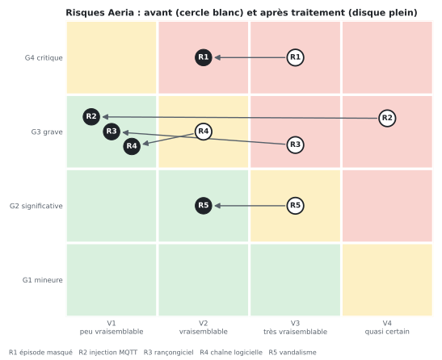

# Rapport — Module 5 : sécurité de la plateforme Aeria

**Projet Aeria** — plateforme ouverte de surveillance de la qualité de l'air
Auteur : BRINIS Aya — novembre 2026
Dépôt : <https://github.com/brinis-aya/aeria-security>

---

## 1. Objectif et démarche

Une plateforme qui publie un indice de qualité de l'air engage sa crédibilité, et peut-être la santé de ses
lecteurs. Ce module traite la sécurité d'Aeria de bout en bout :

1. **Analyser les risques** avec EBIOS Risk Manager : partir de ce qui compte (les valeurs métier), pas des
   outils.
2. **Auditer** la plateforme réelle : nmap, Varys, tests applicatifs, analyse des dépendances. L'audit
   confirme ou infirme les vraisemblances retenues.
3. **Corriger** dans les modules concernés, puis **re-tester** : chaque correction a une preuve « avant » et
   « après ».
4. **Détecter** ce qui ne peut pas être empêché : règles Wazuh, testées.
5. **Situer** l'ensemble par rapport à un référentiel : déclaration d'applicabilité ISO/IEC 27001:2022.

Documents :

- [`ebios-rm.md`](ebios-rm.md) : analyse de risques complète ;
- [`audit.md`](audit.md) : constats techniques et preuves ;
- [`iso27001-soa.md`](iso27001-soa.md) : déclaration d'applicabilité ;
- [`../wazuh/`](../wazuh) : règles de détection.

## 2. Analyse de risques (synthèse)

L'étude retient **cinq valeurs métier** :

- les mesures ;
- l'indice publié ;
- la maintenance ;
- les données des techniciens ;
- le code et sa chaîne de livraison.

L'événement redouté le plus grave n'est pas une fuite de données : c'est un **épisode de pollution masqué**
(G4), qui priverait des personnes vulnérables d'une information de prévention.

Les **sources de risque** pertinentes sont :

- un industriel de la zone portuaire qui voudrait masquer ses dépassements ;
- un militant qui chercherait une fausse alerte spectaculaire ;
- un cybercriminel opportuniste (rançongiciel) ;
- des vandales ;
- un attaquant de la chaîne logicielle.

La cartographie de l'écosystème met en évidence un maillon peu technique : les réseaux Wi-Fi des bâtiments
municipaux qui hébergent les capteurs. C'est la partie prenante la plus dangereuse (3,0), cohérente avec le
premier incident de maintenance observé dans le module 4 : les capteurs muets.

| Risque | Avant | Après | Commentaire |
|---|---|---|---|
| R1 : épisode masqué par un capteur manipulé | G4 / V3 | G4 / V2 | **risque résiduel principal** : la manipulation physique se détecte, elle ne s'empêche pas |
| R2 : fausses mesures injectées par MQTT | G3 / V4 | G3 / V1 | accès anonyme supprimé en production, ACL par capteur |
| R3 : rançongiciel sur le back-office | G3 / V3 | G3 / V1 | plus exposé, verrouillage, dépendances à jour, journal et détection |
| R4 : chaîne d'approvisionnement logicielle | G3 / V2 | G3 / V1 | analyse OSV hebdomadaire ; actions épinglées par SHA à faire |
| R5 : vandalisme et vol | G2 / V3 | G2 / V2 | accepté : coût limité, détection du silence en moins d'une heure |



## 3. Audit technique

**Règles d'engagement** :

- seule la plateforme de l'auteur, sur son propre poste, a été testée ;
- aucun autre appareil du réseau domestique n'a été scanné ;
- le test de devinette de mot de passe visait le compte de démonstration ;
- les règles Wazuh ont été testées sur un manager jetable.

**Outils** :

- nmap 7.95, embarqué dans le conteneur de Varys : pas d'installation sur le poste ;
- Varys lui-même, pour ses règles de risque et ses preuves chaînées ;
- le client Mosquitto ;
- deux scripts écrits pour l'occasion : contrôles web, et analyse des dépendances via osv.dev.

| Constat | Gravité | Correction | Preuve après |
|---|---|---|---|
| F1 : back-office ouvert sur le Wi-Fi, en HTTP | élevée | écoute sur 127.0.0.1 par défaut (module 4) | nmap : 8084 *closed* |
| F2 : MQTT anonyme, usurpation d'identité de capteur possible | élevée | configuration de production : comptes, ACL, TLS (module 1) | 4/4 tests dans le broker |
| F3 : pas de limite de tentatives de connexion | moyenne | verrouillage après 5 échecs (module 4) | bon mot de passe refusé après 20 échecs |
| F4 : 69 et 76 vulnérabilités connues dans les dépendances Java | élevée | Spring Boot 3.5.16 et versions corrigées de Tomcat, Jackson et du pilote PostgreSQL (modules 1 et 4) | OSV : 2 restantes par module, sans objet ici (`audit.md` §5) |
| F5 : API sans en-têtes de sécurité, bannière visible | faible | middleware d'en-têtes (module 3) | contrôle web |
| F7 : aucun journal de sécurité | moyenne | journal `AERIA-SECURITY` normalisé (module 4) | 5 nouveaux tests ; journaux réels |

Deux constats valent d'être soulignés.

- **L'outil maison a ses angles morts.** Varys n'a pas signalé le back-office en HTTP sur 8084 : sa règle
  « HTTP en clair » ne regarde que les ports 80 et 8080. Seule la lecture des résultats bruts de nmap l'a
  révélé. Croiser deux outils n'est pas un luxe.
- **Un faux positif évité.** Une première version de mon script de contrôle indiquait `/actuator/env` et
  `/actuator/heapdump` « accessibles » (HTTP 200). C'était la page de connexion, atteinte en suivant la
  redirection. Une fois les redirections désactivées, ces points renvoient bien 302 : seul `/health` est
  public.

Hors périmètre, l'audit relève aussi des services du poste exposés sur le Wi-Fi :

- un PostgreSQL natif sur 5432 ;
- le laboratoire Wazuh et Varys ;
- le partage de fichiers Windows.

Il relève aussi que le manager Wazuh du laboratoire ne traite plus d'événements depuis l'arrêt brutal de
Docker. Ces points sont signalés à l'utilisateur du poste (`audit.md` §6).

## 4. Détection avec Wazuh

Ce qui ne peut pas être empêché doit être vu. Les corrections du module 4 produisent des journaux pensés pour
être analysés, au format stable `clé=valeur` :

```
AERIA-SECURITY event=login_failure user=responsable ip=192.168.1.50 reason=BadCredentialsException
```

Un identifiant contenant un saut de ligne ne peut pas fabriquer une fausse ligne : les espaces et caractères
de contrôle sont neutralisés. Un test le vérifie, et un scénario Wazuh aussi.

Quinze règles couvrent trois sources :

- le back-office : échec, force brute, verrouillage, **connexion réussie juste après une force brute**
  (niveau 12, la plus importante), abus de droits répétés ;
- l'ingestion des capteurs : rafale de mesures rejetées pour un même capteur, signe d'une panne ou de
  messages forgés (scénario SO2) ;
- Mosquitto : clients refusés en rafale, connexion MQTT en clair depuis le réseau.

Chaque règle porte sa technique MITRE ATT&CK.

**Test** : 15 scénarios rejoués avec `wazuh-logtest` sur un manager Wazuh 4.14.9 : **15/15**. Trois erreurs
de ma première version ont été trouvées ainsi :

- un champ statique (`dstport`) testé avec `<field>` ;
- une négation `!127.0.0.1` que cette version n'interprète pas : elle inversait la règle ;
- la sortie de `wazuh-logtest`, écrite sur stderr.

Sans ces tests, les règles auraient semblé correctes et n'auraient jamais déclenché d'alerte. La CI rejoue
les scénarios à chaque modification.

## 5. Conformité ISO/IEC 27001:2022

35 mesures de l'annexe A examinées :

| Statut | Nombre |
|---|---|
| Appliquées, avec une preuve dans les dépôts | 20 |
| Partielles | 12 |
| Planifiées | 3 |

Les écarts principaux :

- HTTPS du back-office ;
- sauvegardes (5.30, 8.13) ;
- authentification multifacteur ;
- chiffrement de la flash des capteurs (8.24) ;
- formation (6.3).

## 6. Formation et certifications

| Certification | Organisme | Volume | Statut |
|---|---|---|---|
| SecNumacadémie | ANSSI | ~20 h | en cours |
| Introduction to Cybersecurity | Cisco Networking Academy | ~6 h | en cours |

Le MOOC SecNumacadémie de l'ANSSI compte 4 modules : panorama de la SSI, sécurité de l'authentification,
sécurité sur Internet, sécurité du poste de travail et nomadisme. Les attestations seront ajoutées dans
`docs/` une fois obtenues.

Le module 1 (panorama) recoupe directement ce travail : gestion des risques, défense en profondeur. Le
module 2 (authentification) aussi : mots de passe, verrouillage, MFA.

## 7. Limites

- **Environnement de développement.** L'audit porte sur un déploiement sur poste, pas sur une infrastructure
  de production : pas de proxy, pas de pare-feu réseau. Les recommandations HTTPS et proxy restent à
  vérifier sur une vraie cible.
- **Pas de test d'intrusion applicatif approfondi** (injection SQL, XSS, contrôle d'accès exhaustif). Les
  défenses sont en place (requêtes paramétrées, échappement Thymeleaf, CSP, tests de rôles), mais aucun
  outil dédié comme OWASP ZAP n'a été passé.
- **Firmware ESP32 non audité.** Le chiffrement de la flash et le secure boot sont recommandés (M9) mais pas
  mis en œuvre.
- **Vulnérabilités résiduelles.** Certaines vulnérabilités de Spring Framework ne sont corrigées qu'en
  version 7 (Spring Boot 4). Elles concernent des fonctions qu'Aeria n'utilise pas (`XsltView`, rendu de
  fragments en SSE) : elles sont documentées et non exploitables ici.

## 8. Lien avec les autres modules

| Module | Apport de la sécurité |
|---|---|
| 1 | configuration MQTT de production, Spring Boot à jour, règles sur les rejets d'ingestion |
| 3 | en-têtes de sécurité, bannière masquée |
| 4 | écoute locale, verrouillage, journal de sécurité, en-têtes, Spring Boot à jour ; ses règles métier (traçabilité RG12) sont une mesure du socle |
| 6 | le tableau de bord public n'expose que des données ouvertes ; l'API du back-office reste authentifiée |
